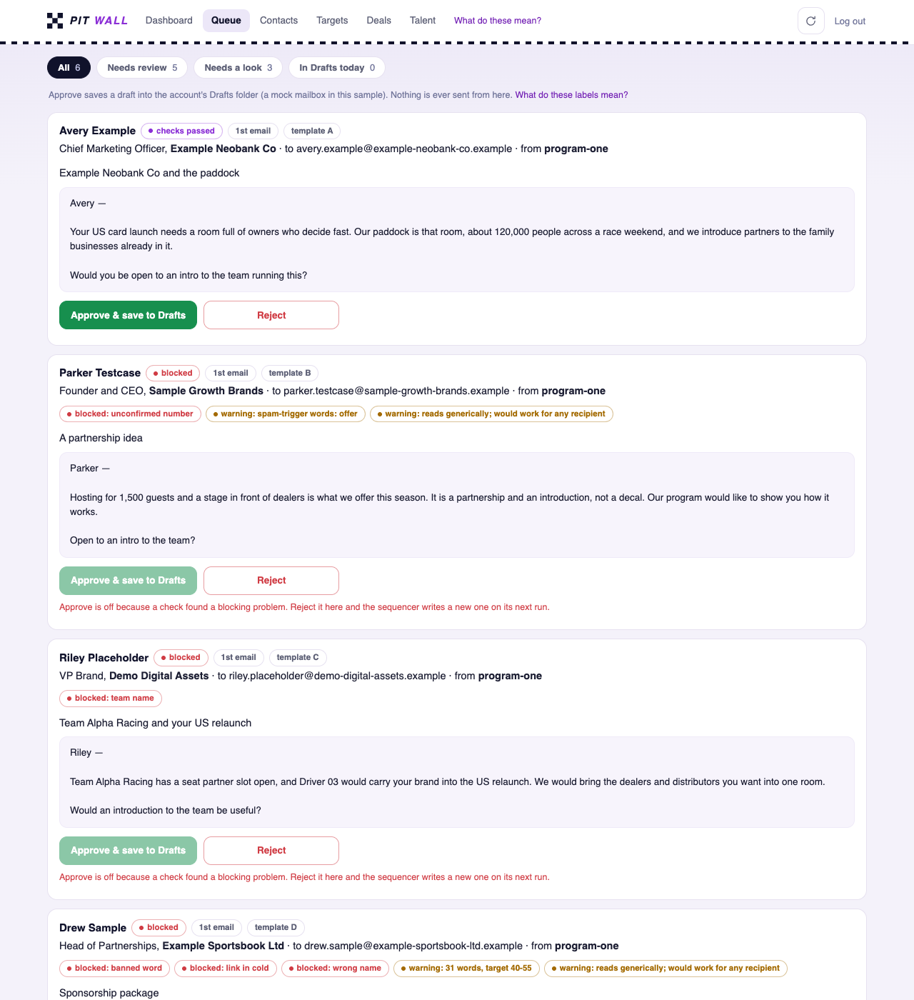
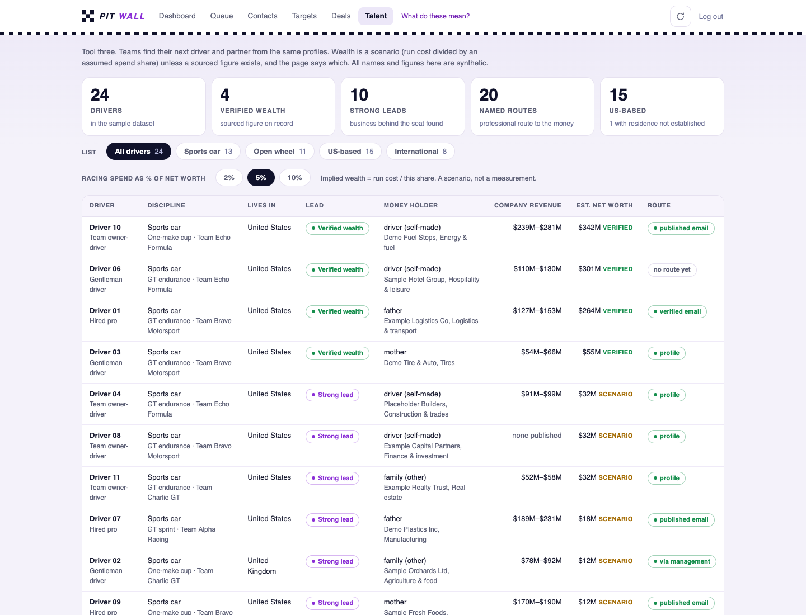
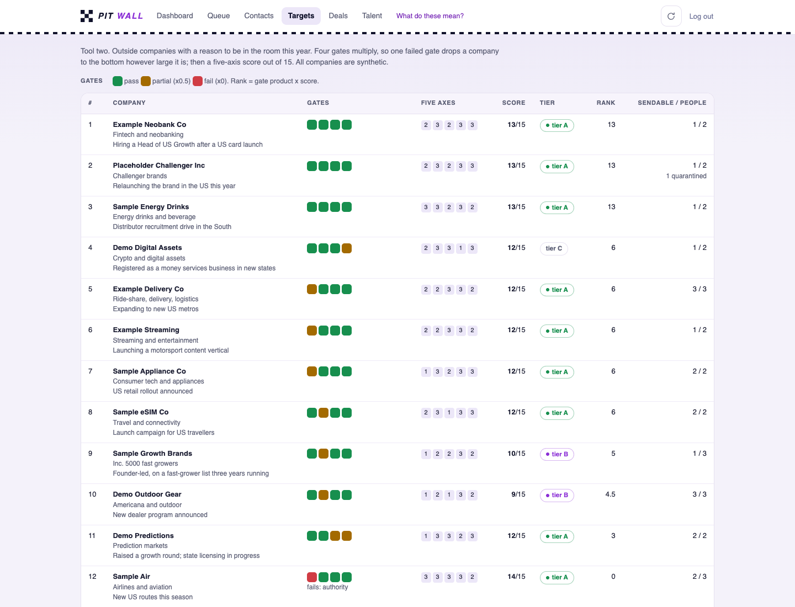
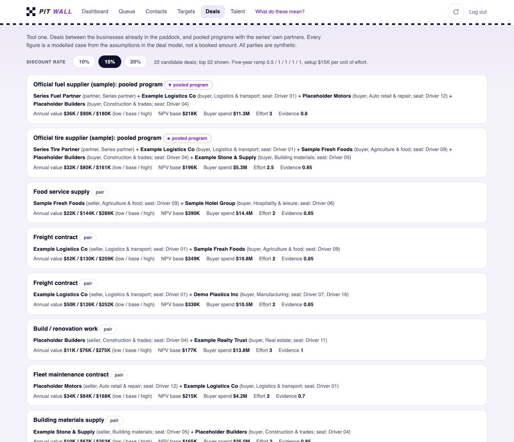
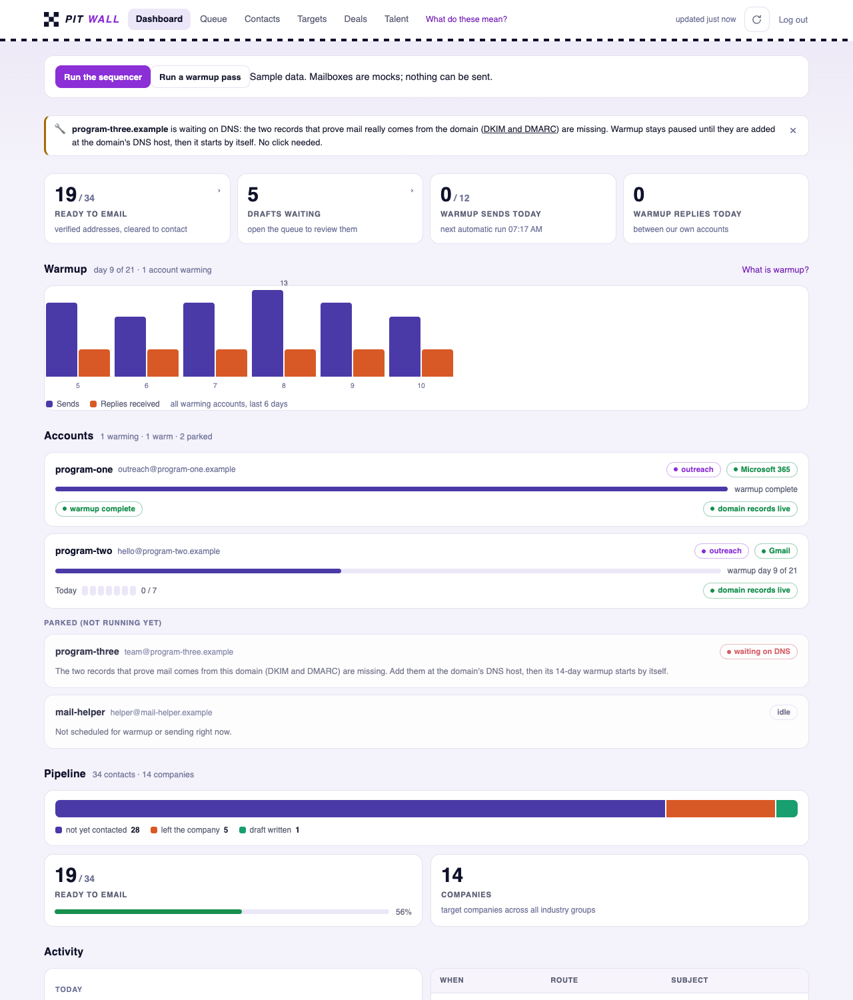
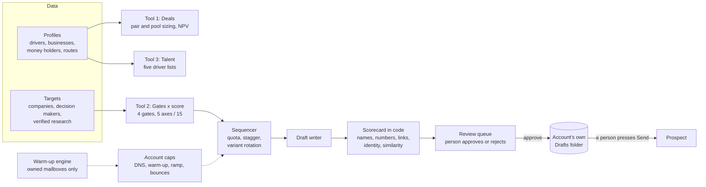

# Pit Wall

Mapping the paddock as a market. One usable profile of every participant in a racing paddock, and three tools built on it: deals between the businesses already inside, outside businesses brought in, and teams finding their next driver and partner. Created for one race program heading into the Indy 500, across IndyCar and IMSA, and licensed to other programs since.

**Case study:** [dandoungroup.com/case-studies/#pit-wall](https://dandoungroup.com/case-studies/#pit-wall) · **Live app:** [pitwall.dandoungroup.com](https://pitwall.dandoungroup.com/) (private, login required)

> **About this repo.** This is a public snapshot of a private application. The live app runs on the real paddock dataset and is updated continuously: new profiles, deals, targets and outreach rules land there first. This copy is fixed at the point it was published, runs on synthetic data, and is not updated alongside the live app.



*Every name, company, address and figure in this repository is synthetic.*

## The problem

A race program usually funds itself through sponsorship: a brand pays for a decal and hospitality, measures impressions, and decides each winter whether to do it again. The money is thin, it rarely renews on its own, and the sale starts from zero every year.

Behind most seats in the paddock is a business: a family company with published revenue that pays for the car and also buys and sells things. Those businesses stand in the same paddock for three days every race weekend. Nobody had mapped them as a market, and nobody had mapped which outside companies have a real reason to be in that room.

Two questions had the same shape:

- Which companies would pay to be in the paddock, and could sign without a committee?
- Which drivers could fund a seat, who holds the money behind each one, and how do you reach that person professionally without going through their current team?

## What it does

**One profile dataset.** A record for every driver: discipline, series, residence, the business behind the seat, its revenue where published, who holds the money, and a professional route to that person. Net worth is backed into from the series run cost and an assumed spend share, and is labelled a scenario until a sourced figure replaces it.

**Tool one: inside deals.** Pairs businesses already in the paddock (a trucking company and a fruit exporter, a builder and a property owner) and pools family businesses into programs with the series' own partners. The worked example from the engagement is a fleet tire deal: a regional trucking company buys a fleet tire program from the series tire sponsor, an agricultural exporter moves its fruit on that fleet, the sponsor books volume, and the savings are split back into both families' seats. Each candidate deal is sized from buyer spend and seller capacity, with low, base and high cases and a five-year NPV.

**Tool two: outside partners.** Maps companies with a reason to be at the track this year, puts each through four gates (one person can decide alone, a budget line exists, there is a US surface to use what the car offers, the company can legally operate and promote here), scores the ones that clear on five axes out of 15, and works the decision makers through an outreach engine built so that a wrong email cannot leave.

**Tool three: talent.** Five driver lists over the same profiles (all, sports car, open wheel, US-based, international), so teams can find their next driver and the partners behind them.

**Licensed.** Built for one program and licensed to other programs since.

| Talent | Targets |
|---|---|
|  |  |

| Deals | Dashboard |
|---|---|
|  |  |

## How it works



The outreach path is built around one rule: **models write prose; code decides volume, timing, and whether anything may leave; a person presses Send.**

- **Caps in code.** An account's daily cap is zero if it is a support account, if DKIM or DMARC is not live on its domain, if it is still warming up, if its ramp has not been started, or if bounces over the last 30 logged days pass 3% on at least 20 sends. Nobody can hand work to an unsafe mailbox. See [`src/outreach/quota.ts`](src/outreach/quota.ts).
- **Identity before deliverability.** A LinkedIn-level match is the person; company domain plus full name from a named source is probable; a company-level match is quarantined; a pattern guess is never sent to without a person confirming it. Evidence can only upgrade a record. See [`src/targets/identity.ts`](src/targets/identity.ts).
- **A scorecard no one can talk past.** Team and driver names, a wrong greeting, and unresolved merge tokens are critical blocks that cannot be overridden. A number that is not in a verified research item blocks the draft. Links, the word "sponsorship", calendar asks on the wrong variant, and near-duplicate copy across accounts all block too, and any non-critical override is recorded. See [`src/outreach/lint.ts`](src/outreach/lint.ts) and [`src/outreach/numbers.ts`](src/outreach/numbers.ts).
- **Approval places a draft; it never sends.** The server re-checks state, contact status, identity, suppression, the stored scorecard and the mailbox connection on every approve, then puts the draft in the sending account's own Drafts folder. The mailbox adapter for drafts has no send method. See [`src/outreach/approve.ts`](src/outreach/approve.ts) and [`src/mail/mailbox.ts`](src/mail/mailbox.ts).
- **Warm-up only between owned mailboxes.** The transport re-checks a frozen allowlist on both ends of every message. Warm-up holds until DNS is live, tapers at weekends, and drops to a maintenance trickle after the ramp instead of going quiet. See [`src/warmup/`](src/warmup).

Layout:

```
src/
  profiles/   wealth scenario, the five lists
  deals/      pair and pooled-program sizing, NPV
  targets/    gates and five-axis score, identity ladder
  outreach/   quota, sequencer, draft writer, scorecard, approval checks
  warmup/     warm-up planning and one run of the engine
  mail/       mailbox adapter interfaces and the in-memory mocks
  store/      in-memory store seeded from data/sample
  api/        request handlers shared by Netlify and the local server
netlify/      one function for /api/*, a scheduled warm-up trigger, the edge auth gate
public/       static pages, no framework, no build step
db/schema.sql the production Postgres schema
data/sample/  synthetic data, generated by scripts/make-sample-data.ts
test/         node:test suites for the guardrails, the tools and the API
```

## Stack

TypeScript on Node (run directly, no build step), Netlify Functions and an Edge Function for the auth gate, Netlify Database (Postgres) in production, plain HTML, CSS and JavaScript on the front end. Mail in production goes through Microsoft Graph and Gmail (IMAP and SMTP); this repository replaces both with in-memory mocks. Tests use the built-in `node:test` runner.

## Results

From the engagement, July to October 2026:

- 686 drivers mapped with the business behind the seat; 127 with verified family wealth; 341 named routes to the money holder; 5 driver lists.
- 752 decision makers at 149 companies across 14 verticals, every email identity-verified or quarantined; 476 verified sendable emails.
- Four gates and a five-axis score replaced a size-sorted list, so the companies at the top can actually sign.
- One fleet tire deal brokered between two drivers' family businesses and the series tire sponsor, with the savings split back into both racing programs.
- About 125 sends a day of warmed capacity across the program's own domains, with DNS, warm-up and bounce gates that set a cap to zero on their own.
- All three tools licensed to other programs.

Full write-up: [dandoungroup.com/case-studies/#pit-wall](https://dandoungroup.com/case-studies/#pit-wall)

## Limits

- **The pool is the constraint, not capacity.** About a third of the sponsor pool has no verified email. Name-only matches were thrown away on purpose.
- **Wealth is a scenario for most drivers.** It was verified for 127 of 686; the rest show run cost and an assumed spend share, and say so.
- **The live machine runs in two places.** The daily sequencer and send detection run on a Mac; the review queue, warm-up and lists run on the web. A draft approved on one is invisible to the other until they are joined.
- **Access control is the weakest link.** One shared password and an HMAC session cookie. Per-user logins are the next fix.
- **This repository is a runnable model of the system, not the system.** The store is in memory and resets on restart (and per function instance on Netlify). Mailboxes are mocks. The draft writer is a set of templates, where the live system has a language model write the prose. The deal sizing keeps the live structure (spend, capacity, capture, margin, ramp, NPV) with illustrative parameters. Follow-up touches, send detection and reply detection are not included.

## Run it locally with sample data

Requires Node 22.18 or later (it runs the TypeScript directly).

```sh
npm test            # 33 tests, no install needed
npm run dev         # http://localhost:8888, password: demo
```

On the dashboard, **Run the sequencer** writes first-touch drafts for the one account that is warm and ramping (the other two show why their caps are zero), and **Run a warm-up pass** exchanges notes between the owned mock mailboxes. Approve a clean draft in the queue and it appears in the mock Drafts folder at the bottom of the page. Nothing can be sent.

To regenerate the sample data: `npm run sample-data`. To typecheck: `npm install && npm run typecheck`.

To deploy the sample to Netlify, set `PITWALL_PASSWORD`, `SESSION_SECRET` and `CRON_SECRET` (see `.env.example`) and deploy; there is no build command.

## Author

Anthony Nader. A side project. MIT licensed.
